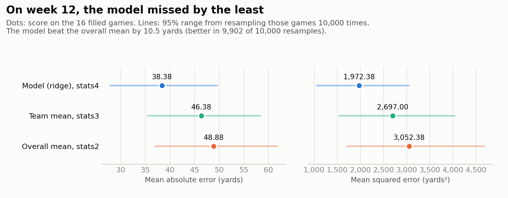
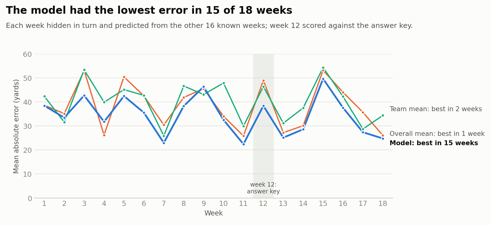
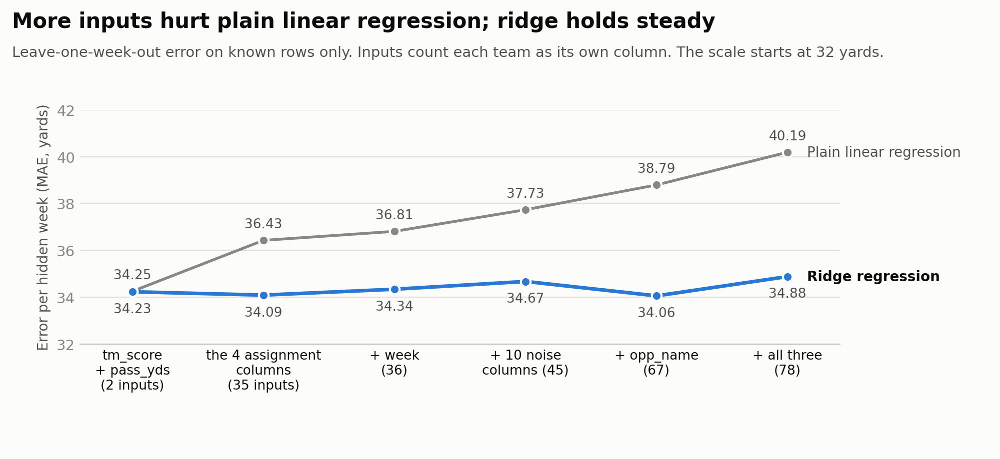

# Filling Missing Rushing Yards: Mean vs Team Mean vs Model

**Juan Zavala** · AI for Analytics · built with Claude as a pair programmer

`season_stats.csv` has 272 games, one row per winning team. **All 16 missing `rush_yds` values are from one week, week 12.** The whole week was never recorded. I filled the gap three ways and scored each against the answer key, `actual.csv`, which no code read until the expected errors were committed to git.

| | stats2: overall mean | stats3: team mean | stats4: model |
|---|---|---|---|
| How it fills the 16 games | The average of the 256 known games (127 for every game) | Each team's average from its own known games | Ridge regression on `name`, `tm_score`, `opp_score` and `pass_yds` |
| **MAE** (yards) | 48.88 (worst) | 46.38 | **38.38 (best)** |
| **MSE** (yards²) | 3,052.38 (worst) | 2,697.00 | **1,972.38 (best)** |
| Rank expected *before* any code read the answer key | 2 | 3 | 1 |
| Actual rank | 3 | 2 | **1** |

**Bottom line:**

- **The model is the best method on both metrics.** Its lead over the overall mean holds up under resampling: it was better in 9,902 of 10,000 resamples. It also had the lowest error in 15 of 18 weeks when every week was scored the same way.
- **The team mean and the overall mean are effectively tied.** Which one wins depends on the week.

**Start here:**

* [`rushing_yards_imputation.ipynb`](rushing_yards_imputation.ipynb): the full analysis, Parts 1 to 8, with every check. GitHub shows it with all outputs.
* [`part1_exploration.md`](part1_exploration.md): the null analysis, the discussion and the plan, written before any modeling.
* [`reflection.md`](reflection.md): the Part 9 reflection, each answer backed by results.
* [`imputation_lab.html`](imputation_lab.html): an interactive dashboard. Download it and open it in any browser to step through any week, switch between MAE, MSE and RMSE, and explore the column test.

---

## Three findings

### 1. On week 12, the model missed by the least



The model's MAE (38.38 yards) is 10.5 yards lower than the overall mean's, and the 95% range of that difference (−18.8 to −1.8) stays below zero. Against the team mean, the model is likely better (in 9,055 of 10,000 resamples), but that range (−19.6 to +3.9) includes zero. The lead is larger on MSE than on MAE (35% vs 21% lower than the overall mean), because MSE punishes big misses and the model avoided some of the biggest.

### 2. The pattern holds across the season



Sixteen games is a small test, so every known week was also hidden in turn and predicted from the other 16 known weeks (leave-one-week-out):

- **The model had the lowest error in 15 of 18 weeks.**
- **The team mean and the overall mean split the weeks.** The team mean was better in 7 of 18 weeks by MAE and 10 of 18 by MSE, even though it uses more information.
- One caveat: the 17 known weeks are the same hidden-week results used to *choose* the model. Week 12 is the only week not used to choose the model, and the model won it too.

Week 12 itself was a heavy rushing week: it averaged 141.6 yards, the 5th-highest of 18 weeks and inside the normal range (p = 0.31). So all three methods guessed low on average.

### 3. More columns are not more accuracy



The column test is extra work beyond the assignment. Count what the model actually receives: the four assignment columns become 35 inputs, because each of the 32 teams gets its own column. Plain linear regression got worse with every addition, from 36.43 with those 35 inputs to 40.19 with 78 (adding `week`, 10 columns of random noise and `opp_name`). Ridge regression held steady (34.06 to 34.88), because its penalty shrinks useless inputs toward zero. And just two columns, `tm_score + pass_yds`, do nearly as well (34.23) as all four (34.09).

---

## Every assignment question, answered

| § | Question | Answer | Where |
|---|---|---|---|
| 1 | Any nulls? | Only `rush_yds`: 16 of 272 (5.88%) | Part 1 |
| 1 | Do the null rows share anything? | **All are week 12, and every week-12 game is null.** Otherwise week 12 is typical: its scores and passing yards match the other weeks (all p > 0.3) | Part 1, `part1_exploration.md` |
| 2 | Load `stats`; make `stats2`–`stats4` | Done. The copies are independent (checked in Part 2), and `stats` still has its 16 nulls after all three fills (asserted in Part 6) | Parts 2 and 6 |
| 4 | Mean fill, kept as int | 127 for all 16 games. `int64`, no nulls, known values untouched (all asserted) | Part 4 |
| 5 | Team-mean fill, kept as int | 108 (Chiefs) to 178 (Bears); hand-checked for 3 teams; no fallback needed | Part 5 |
| 6 | Model fill from 4 columns, kept as int | Ridge regression, chosen among 4 models by leave-one-week-out cross-validation; predictions from 91 to 159 | Part 6 |
| 3–6 | Pros and cons of each method | Written up after each fill, with evidence | Parts 4, 5, 6 |
| 7 | Read `actual` | Lined up on `(week, name)`: 272 of 272 games matched, and all 256 known values agree | Part 7 |
| 8 | MAE: best and worst? | **Best: stats4 (38.38). Worst: stats2 (48.88)** | Part 8 |
| 8 | MSE: best and worst? | **Best: stats4 (1,972.38). Worst: stats2 (3,052.38)** | Part 8 |
| 9 | Reflection (emailed) | Complex methods help **sometimes**; full answers to all five questions | `reflection.md` |

---

## How Claude was used

Claude (Anthropic's AI, working in Cowork) read the data, proposed approaches, wrote and ran the code, and built every check. I set the direction, reviewed each plan before any code was written, and signed off on the judgment calls. Each part of the notebook follows the order the assignment asks for: Claude explains its plan in short plain-English answers, the plan is reviewed, then code runs, then a check confirms it. The prompts are recorded in the notebook and in `part1_exploration.md`.

**Where an idea didn't hold up, and what caught it:**

| Idea | What the evidence showed |
|---|---|
| Prompt 1's mean fill is done | It left `rush_yds` as a decimal (126.89 for every gap). Prompt 2 rounds to whole yards and keeps the column `int`. |
| The team mean should beat the overall mean, since team explains 19% of the variation in rushing yards | That 19% is in-sample. Hiding whole weeks showed the team mean was *less* accurate (39.79 vs 37.62), because many teams have only a handful of known games (2 to 12), too few to average reliably. |
| More complex models should do better | Gradient boosting, the most flexible model tried, was the least accurate of all six methods (40.56). Ridge regression, which is regularized and only moderately complex, won. |
| Claude's column predictions (written down before the test) | 3 right, 1 mostly right, 1 wrong. The test showed `opp_score` does *not* help alongside `tm_score`. |
| The pre-registered ranking | It called the winner (the model) correctly, but the other two swapped places, consistent with how small their gap is. |

**Judgment calls made along the way:**

* Fills are rounded to whole yards. No average landed exactly on .5, so the rounding rule never mattered.
* The model was chosen by leave-one-week-out cross-validation, because the real data is missing a whole week. A random 5-fold split, run as a second opinion, agreed on the winner (ridge 34.61, against 37.77 for the overall mean and 37.92 for plain linear regression).
* Model settings were fixed in advance. Ridge picks its penalty strength inside each training fold only.
* The team mean falls back to the overall mean for a team with no known games. That never happened here.
* MAE and MSE are scored only on the 16 filled games. Including the 256 copied values would add 256 zero errors and make every method look far better than it is.

## How the numbers were checked

* **The answer key stayed out of the method choices.** The expected errors and ranking were committed (commit `87957e3`) before any code read `actual.csv`, and the git history shows that order. The file was attached to the chat at the start, so its contents were visible. That's why the methods and the selection rule were written down before any modeling.
* **Alignment:** the answer key was joined on `(week, name)` with a one-to-one check. 272 of 272 games matched, and all 256 known values agree.
* **Every fill:** asserted to have no nulls, an integer dtype, and untouched known values.
* **MAE and MSE:** computed twice, with scikit-learn and by hand with numpy, and asserted equal.
* **Uncertainty:** a bootstrap with 10,000 resamples, plus head-to-head comparisons on the same resampled games.
* **The dashboard:** its scoring engine was checked against the same calculations in Python (117 checks, 0 mismatches).
* **Reproducibility:**
  - The notebook gives identical results on Python 3.11 with pandas 3.0.2, and on Python 3.10 with pandas 2.3.3 (same fill values, scores and results files).
  - Both setups use scikit-learn 1.6.1.
  - Every code cell is also valid Python 3.9.

## Limitations

* **Small test:** only 16 games were scored against the answer key, so the 95% ranges are wide. The 18-week scoreboard is broader evidence, but 17 of its weeks are the same results used to choose the model.
* **Week 12's luck:** it was a heavy rushing week, so every method guessed low (by 6 to 15 yards on average).
* **Winners only:** every row is a winning team, so the results describe winners' games.
* **Big days:** no method predicts them. The Rams and Falcons each rushed for 228 yards in week 12, and every method missed both games by 73 yards or more.

## Files

| File | What it is |
|---|---|
| `README.md` | This page |
| `part1_exploration.md` | Part 1: the null analysis and the plan, before any modeling |
| `rushing_yards_imputation.ipynb` | Parts 1 to 8, executed with all outputs |
| `reflection.md` | Part 9 reflection (the emailed deliverable) |
| `imputation_lab.html` | Interactive dashboard in one file, with all its data and code inside. It loads two web fonts when online and falls back to system fonts offline |
| `requirements.txt` | Python packages |
| `data/season_stats.csv`, `data/actual.csv` | The work file and the answer key |
| `results/preregistered_expectations.csv` | Expected errors, committed before Part 7 |
| `results/imputed_comparison.csv` | Each filled game: actual value, each method's fill, errors |
| `results/method_scores.csv` | MAE and MSE per method, with 95% resampling ranges |
| `results/weekly_method_errors.csv` | Each method's MAE for all 18 weeks |
| `images/` | The three charts above |

## Reproduce it

```bash
cd submissions/juan_zavala
pip3 install -r requirements.txt
jupyter nbconvert --to notebook --execute --inplace rushing_yards_imputation.ipynb
```

Or open the notebook in VS Code, pick a Python kernel and choose **Run All**. A full run took about 35 seconds in testing.
